# 화면 기록

2026-10-10 기준 화면 캡처입니다 (390×844, 2배 해상도). 이미지는 [screens/](screens/)에 있습니다.
모션은 캡처에 담기지 않아 각 화면 아래에 적었습니다.

> 다시 찍을 때: 개발 서버(`npm run dev`)를 켠 상태에서 같은 순서로 화면을 열어 저장합니다.
> 홈은 탭바가 카드를 가리지 않도록 화면 높이 1054로 찍었습니다.

## 1. 온보딩 `/onboarding`

| 인트로 | 민감도 | 피하고 싶은 식물 | 추천 기준 | 완료 |
|---|---|---|---|---|
| 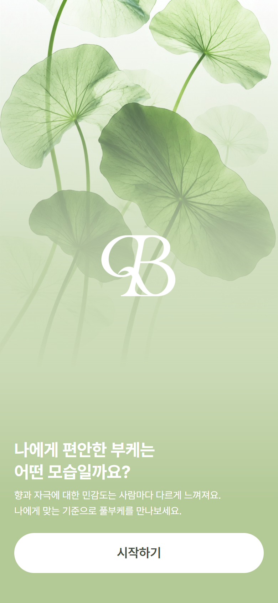 | 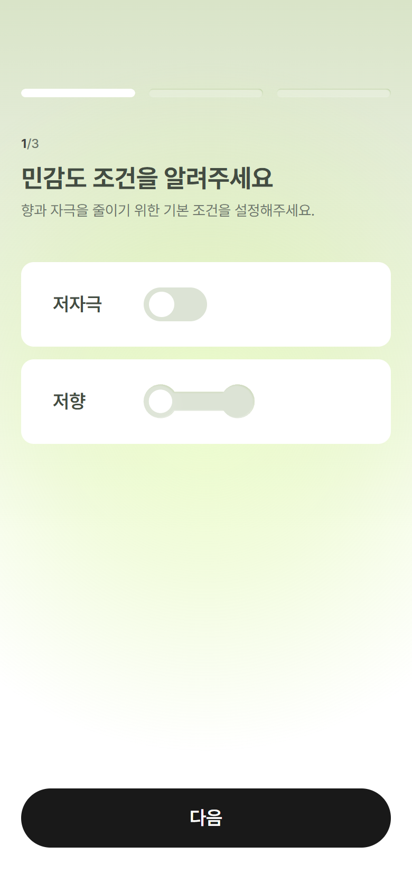 | 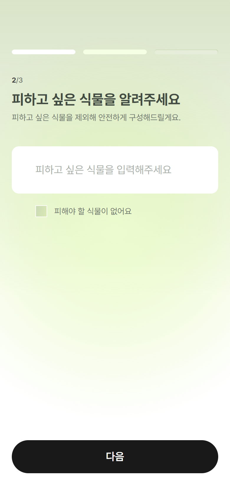 | 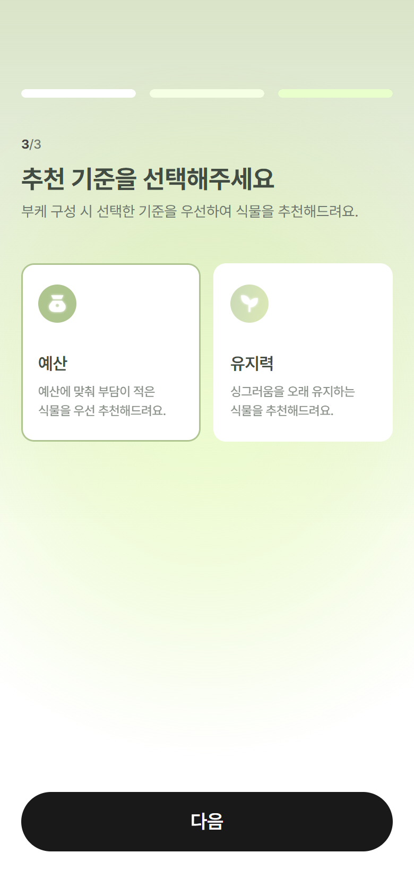 |  |

- Figma 2268:20585 · 20554 · 20756 · 20679 · 20710 · 20539
- 앱을 새로 열 때마다 처음에 한 번. 완료 문구를 잠시 보여준 뒤 홈으로 이어짐.

## 2. 홈 `/`

| 부케 만들기 전 | 부케 만든 뒤 |
|---|---|
| 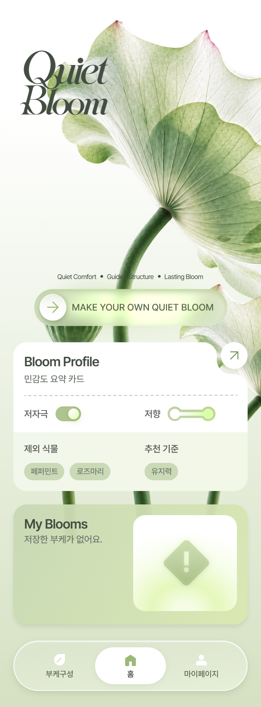 | 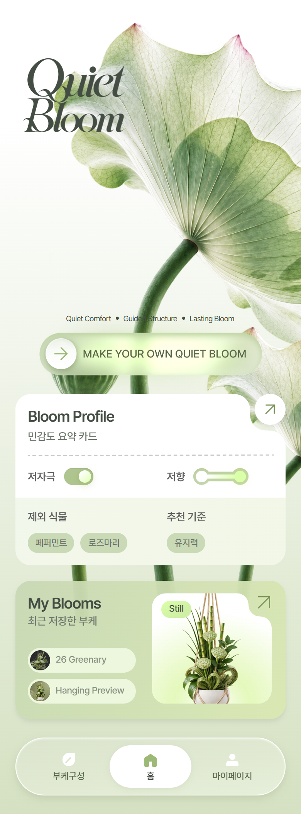 |

- My Blooms 카드: 처음엔 "저장한 부케가 없어요.", 카드 출력까지 마치면 **최근 저장한 부케**(Figma 2268:17297)로 바뀜.
- 슬라이더(MAKE YOUR OWN QUIET BLOOM)를 밀면 흰색·연두 파티클.

## 3. 부케 만들기

| Make Quiet Bloom | 조건 수정 | 구성 안내 딤 | 부케 구성 |
|---|---|---|---|
| 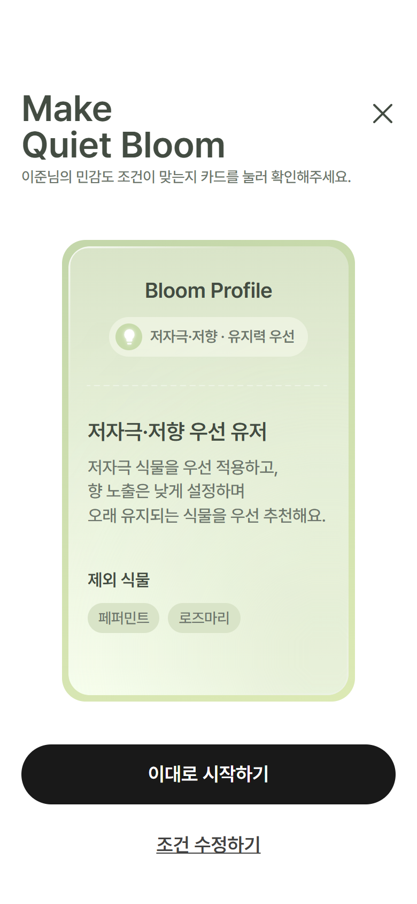 | 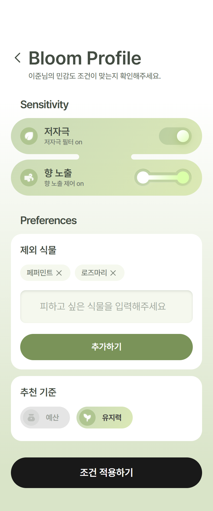 | 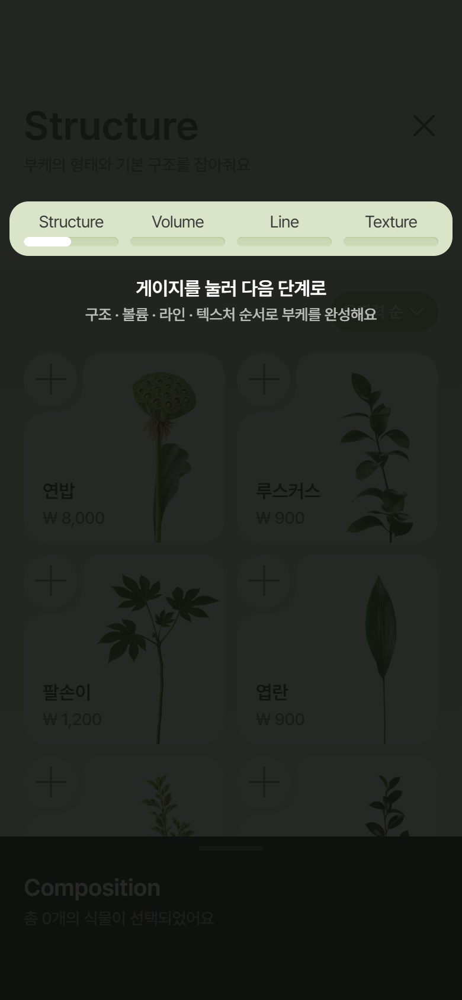 | 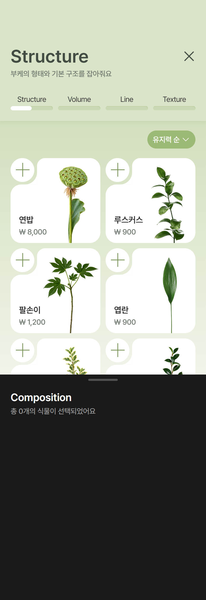 |

- 부케 구성: Structure → Volume → Line → Texture 4단계, 정렬(유지력·예산) 선택 상자, 식물 상세 팝업, 나가기 확인 팝업, Composition 시트.
- 구성 → 프리뷰 사이: 먼지 같은 파티클이 소용돌이치며 부케 실루엣으로 모이는 로딩.

## 4. Bloom Preview `/preview`

| Bloom Preview | AI 프리뷰 |
|---|---|
| 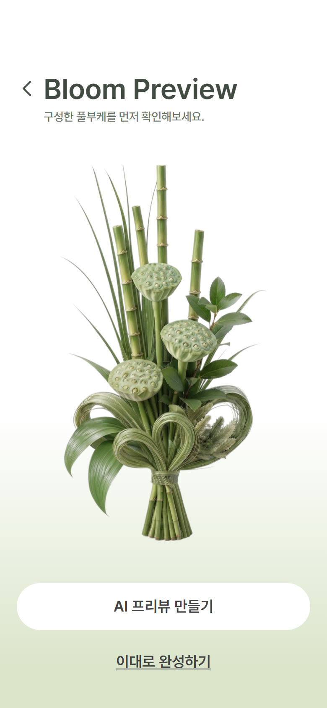 | 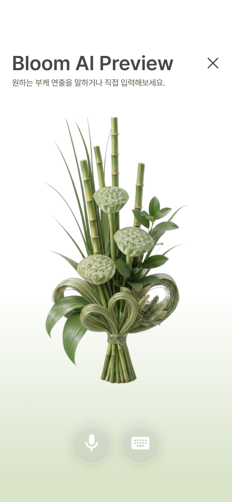 |

- 마이크를 누르면 듣기 시작, 다시 누르면 꺼지고 생성 화면으로. 예시 문장: "화병에 담겨있는 모습으로 바꿔줘" → "천장에 달린 행잉 스타일로 바꿔줘".
- 생성 중: 글자가 떠오르는 제목 + 흐르는 빛 덩어리 (약 6.8초).

## 5. 완성 → 카드 출력

| Bloom Complete | 출력 중 | 출력 완료 |
|---|---|---|
| 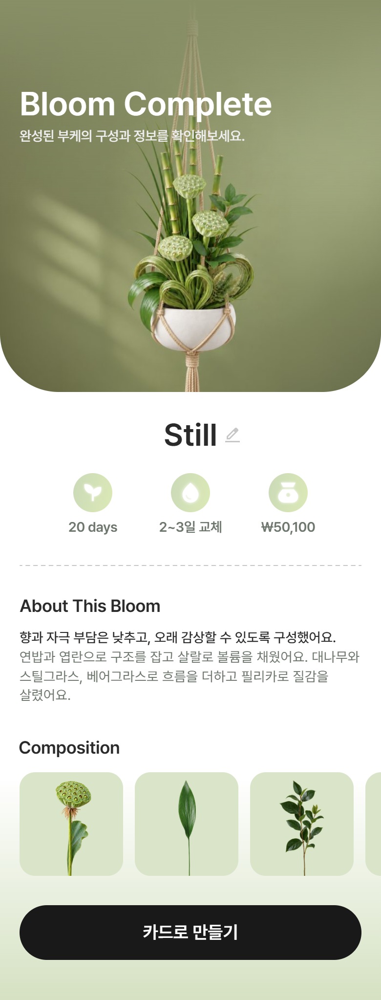 | 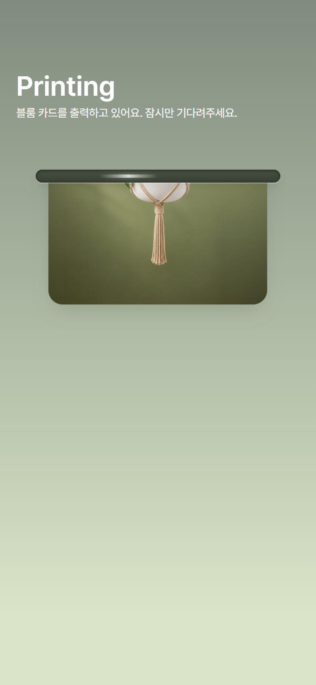 | 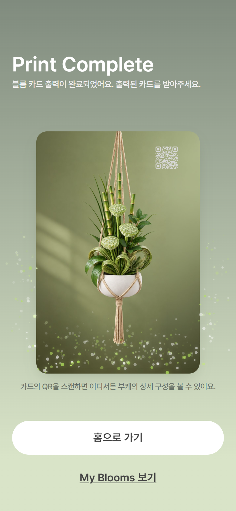 |

- Bloom Complete(Figma 2268:20344): Composition 식물 가로 넘김(PC는 마우스 끌기·휠). **카드로 만들기** → 바로 출력.
- 출력(`/print`, 시안 없음): 프린터 입구에서 카드가 5번에 나눠 끊기듯 밀려 나옴(4.9초, 미세한 떨림, 입구 안 흰 빛이 좌우로). 다 나오면 입구가 사라지고 카드가 살짝 떠올랐다 자리 잡으며 파티클. 카드는 끌어서 기울여볼 수 있음.
- 완료 문구: "블룸 카드 출력이 완료되었어요. 출력된 카드를 받아주세요." / QR 안내: "카드의 QR을 스캔하면 어디서든 부케의 상세 구성을 볼 수 있어요."

## 6. My Blooms `/blooms` · 상세 `/blooms/:id`

| My Blooms | Still 상세 | Calm 상세 | Airy 상세 |
|---|---|---|---|
| 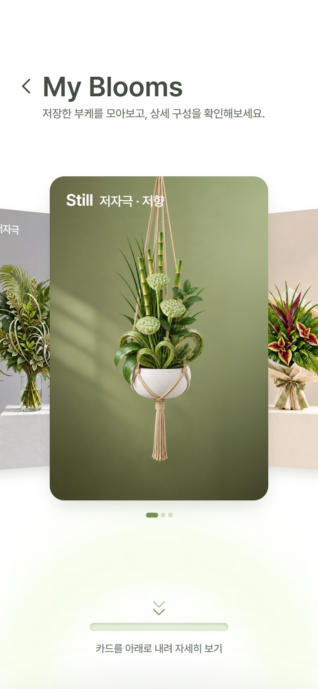 | 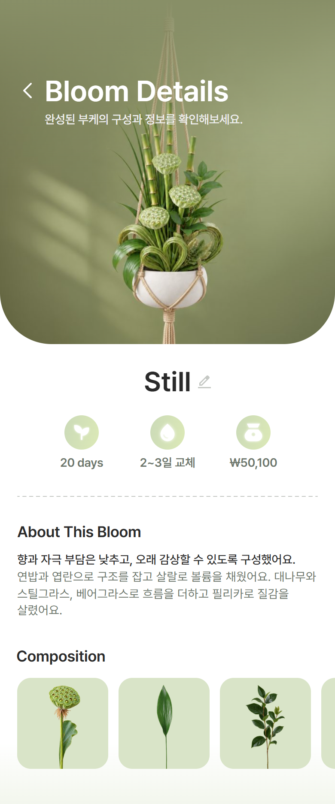 | 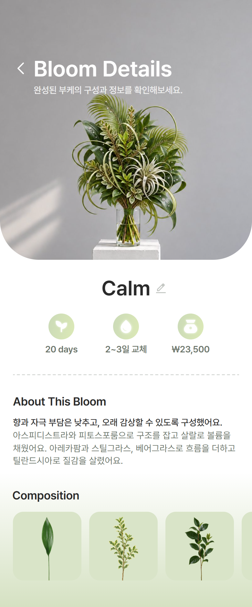 | 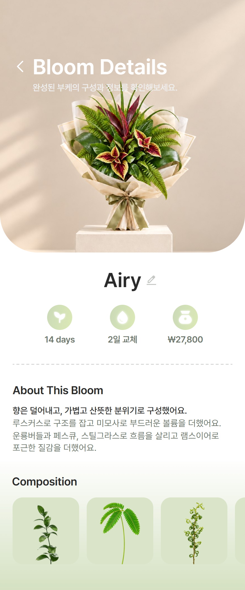 |

- My Blooms(Figma 2268:20919): 들어오면 겹쳐 쌓인 카드가 떠오른 뒤 펼쳐짐. 좌우로 밀면 턴테이블처럼 돌아감(자동 회전 없음, 끝없이 이어짐, 카드 아래 점 줄에서 밀어도 됨).
- 가운데 카드를 잡아 **아래로 내리면** 자세히 보기: 아래에서 둥근 면이 차오르고 카드는 작아지며 돌아 사라짐 → 상세 화면 사진이 위에서 내려옴.
- 상세: Still = Figma 2268:20476(아래 그라데이션 옅게), Calm = 2268:20410, Airy = 시안 없음(임시 내용).

## 7. 마이페이지 `/mypage` · (흐름에서 빠진) Bloom Card `/card`

| 마이페이지 | Bloom Card |
|---|---|
| 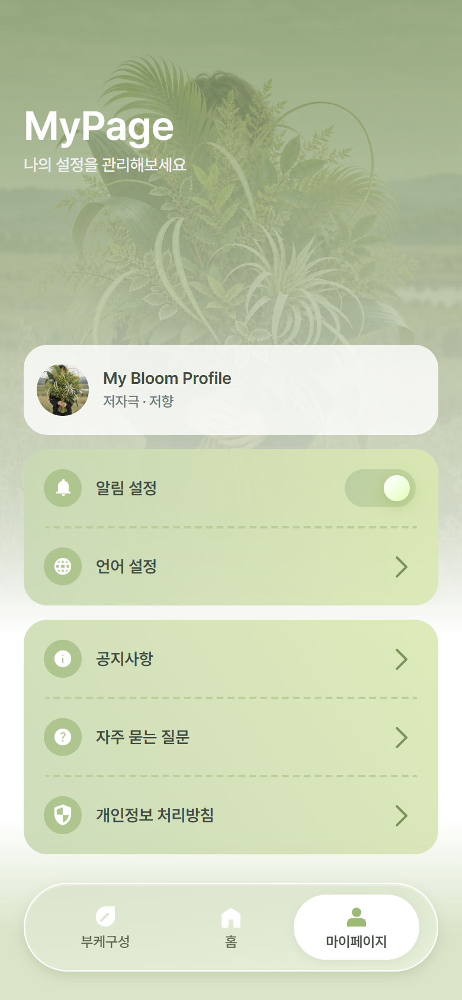 | 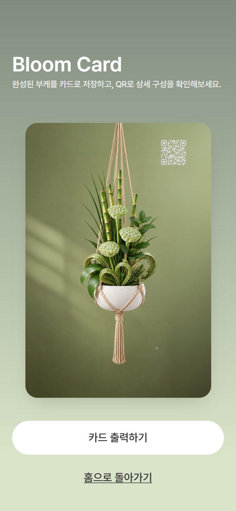 |

- Bloom Card(Figma 2268:20892)는 카드 출력 화면과 겹쳐서 흐름에서 뺐음. 코드는 남아 있음.
